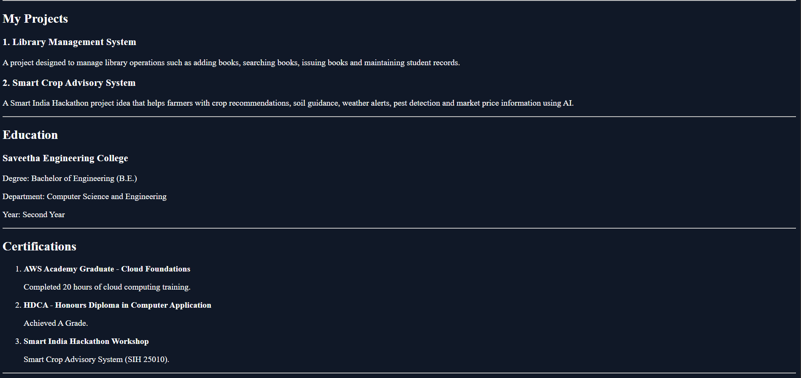
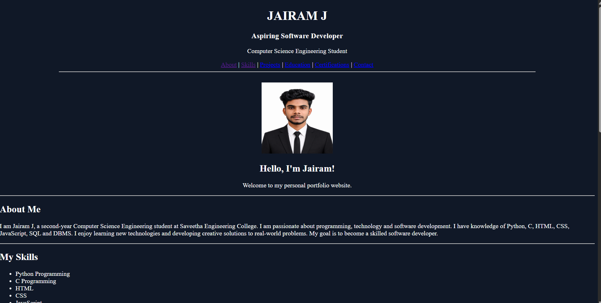
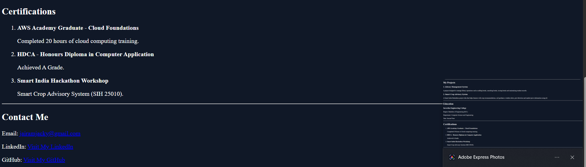

# Portfolio
# AIM
To design and develop a personal portfolio website using HTML to showcase personal information, educational qualifications, technical skills, projects, certifications, and contact details.


# ALGORITHM
1. Start the program.
2. Open Visual Studio Code and create a project folder.
3. Create an HTML file named index.html.
4. Write the HTML code to design the personal portfolio.
5. Add personal details, profile picture, skills, projects, education, certifications, and contact information.
6. Save the HTML file.
7. Create a GitHub account and log in.
8. Create a new repository named my-portfolio.
9. Upload the index.html file and profile image to the repository.
10. Open the repository settings and select Pages.
11. Choose the main branch and / (root) folder as the deployment source.
12. Click Save to publish the website.
13. Open the generated GitHub Pages URL to view the portfolio.
14. Stop the program.

# PROGRAM
```

<!DOCTYPE html>
<html lang="en">
<head>
    <meta charset="UTF-8">
    <meta name="viewport" content="width=device-width, initial-scale=1.0">
    <title>Jairam J | Portfolio</title>
</head>

<body  bgcolor="#101827" text="white">

    <center>
        <h1>JAIRAM J</h1>
        <h3>Aspiring Software Developer</h3>
        <p>Computer Science Engineering Student</p>

        <a href="#about">About</a> |
        <a href="#skills">Skills</a> |
        <a href="#projects">Projects</a> |
        <a href="#education">Education</a> |
        <a href="#certifications">Certifications</a> |
        <a href="#contact">Contact</a>

        <hr width="80%">
    </center>

    <br>

    <center>
        
        <h2>Hello, I'm Jairam!</h2>
        <p>Welcome to my personal portfolio website.</p>
    </center>

    <hr>

    <h2 id="about">About Me</h2>

    <p>
        I am Jairam J, a second-year Computer Science Engineering
        student at Saveetha Engineering College. I am passionate
        about programming, technology and software development.
        I have knowledge of Python, C, HTML, CSS, JavaScript,
        SQL and DBMS. I enjoy learning new technologies and
        developing creative solutions to real-world problems.
        My goal is to become a skilled software developer.
    </p>

    <hr>

    <h2 id="skills">My Skills</h2>

    <ul>
        <li>Python Programming</li>
        <li>C Programming</li>
        <li>HTML</li>
        <li>CSS</li>
        <li>JavaScript</li>
        <li>SQL</li>
        <li>Database Management System (DBMS)</li>
    </ul>

    <hr>

    <h2 id="projects">My Projects</h2>

    <h3>1. Library Management System</h3>
    <p>
        A project designed to manage library operations such
        as adding books, searching books, issuing books and
        maintaining student records.
    </p>

    <h3>2. Smart Crop Advisory System</h3>
    <p>
        A Smart India Hackathon project idea that helps farmers
        with crop recommendations, soil guidance, weather alerts,
        pest detection and market price information using AI.
    </p>

    <hr>

    <h2 id="education">Education</h2>

    <h3>Saveetha Engineering College</h3>
    <p>Degree: Bachelor of Engineering (B.E.)</p>
    <p>Department: Computer Science and Engineering</p>
    <p>Year: Second Year</p>

    <hr>

    <h2 id="certifications">Certifications</h2>

    <ol>
        <li>
            <b>AWS Academy Graduate - Cloud Foundations</b>
            <p>Completed 20 hours of cloud computing training.</p>
        </li>

        <li>
            <b>HDCA - Honours Diploma in Computer Application</b>
            <p>Achieved A Grade.</p>
        </li>

        <li>
            <b>Smart India Hackathon Workshop</b>
            <p>Smart Crop Advisory System (SIH 25010).</p>
        </li>
    </ol>

    <hr>

    <h2 id="contact">Contact Me</h2>

    <p>Email:
        <a href="jairamjacky@gmail.com">
            jairamjacky@gmail.com
        </a>
    </p>

   
    <p>GitHub:
        <a href="https://github.com/jairam733-hub/Portfolio" target="_blank">
            Visit My GitHub
        </a>
    </p>

    <hr>

    <center>
        <h3>Thank You for Visiting My Portfolio!</h3>
        <p>© 2026 Jairam J. All Rights Reserved.</p>
    </center>

</body>
</html>
```
# OUTPUT






# RESULT
Thus, the personal portfolio website was successfully created using HTML and hosted on GitHub Pages for online access.